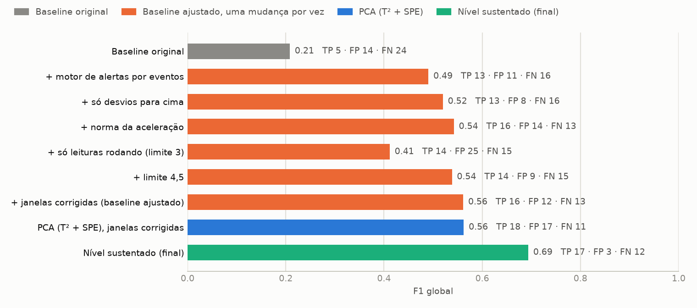
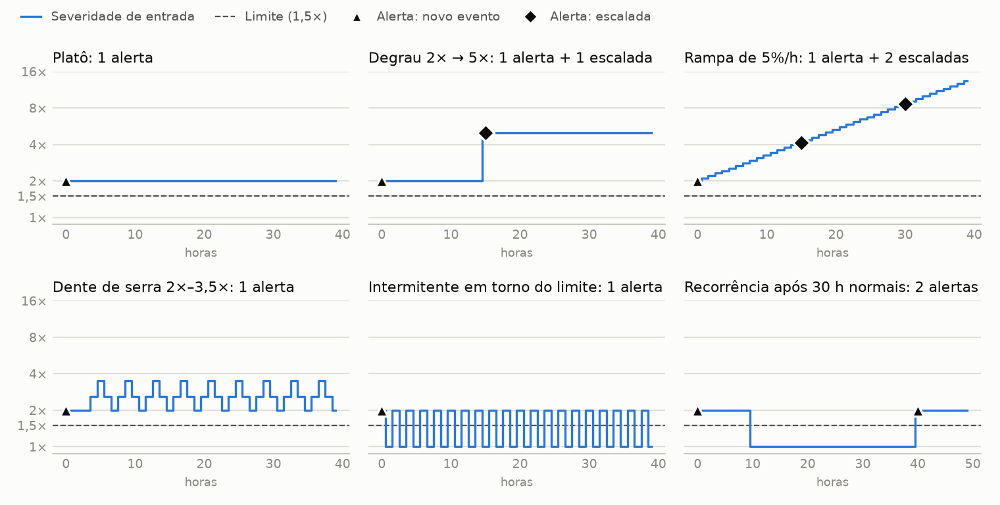
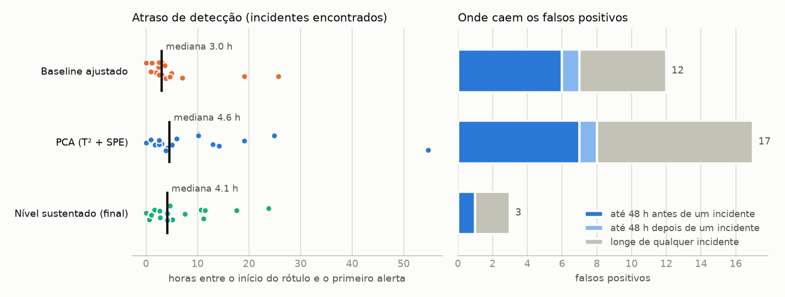

# Detecção de anomalias de vibração — relatório

## Resumo

| | TP | FP | FN | Precisão | Recall | F1 |
|---|---|---|---|---|---|---|
| Baseline como veio | 5 | 14 | 24 | 0,26 | 0,17 | 0,21 |
| Baseline ajustado (só no notebook) | 16 | 12 | 13 | 0,57 | 0,55 | 0,56 |
| PCA (T² + SPE) | 18 | 17 | 11 | 0,51 | 0,62 | 0,56 |
| **Nível sustentado (final, o que o `main.py` roda)** | **17** | **3** | **12** | **0,85** | **0,59** | **0,69** |
| Final, avaliada em cenários que não usei para ajustar | 14 | 5 | 15 | 0,74 | 0,48 | 0,58 |

TP = incidente encontrado, FP = alerta falso (fora de qualquer incidente), FN = incidente perdido.


Cheguei à solução final em três etapas:

1. Corrigi o baseline com o mínimo de mudanças (o **baseline ajustado**).
2. Implementei um detector multivariado (**PCA com T² e SPE**). Ele empatou com o ajustado em F1.
3. Analisei os erros das duas abordagens, entendi o que limitava ambas e construí a **abordagem final**.

Na abordagem final:

- o modelo mede o nível de vibração que a máquina **sustentou** nas últimas 3 horas, separadamente para a velocidade e para a aceleração;
- esse nível é comparado com o **topo do normal daquela máquina**: o percentil 99 do treino com a máquina ligada, ou seja, o valor abaixo do qual ficam 99% das leituras normais;
- o motor de alertas alerta quando um problema começa, fica em silêncio enquanto ele dura, alerta de novo se a vibração dobrar e volta a ficar pronto depois de 24 horas sem anomalia.

Os falsos positivos caíram de 12–17 para 3, com praticamente o mesmo número de incidentes encontrados.

Para ativos novos, o resultado mais realista é o da última linha da tabela (F1 0,58). Os hiperparâmetros foram escolhidos olhando os mesmos 29 cenários em que são medidos, então o F1 de 0,69 é otimista.

Os valores das análises deste relatório vêm do notebook `notebooks/detection_analysis.ipynb`. O resultado da abordagem final também sai de `uv run main.py`.

---

## 1. Métricas: o que escolhi olhar e como interpreto

### O que a métrica oficial mede

- Um incidente conta como **encontrado** (TP) quando pelo menos um alerta cai dentro do período rotulado.
- Todo alerta fora de qualquer período rotulado é um **falso positivo** (FP).
- Precisão, recall e F1 são calculados somando os 29 cenários.

A métrica olha **eventos**, não janelas isoladas, e isso combina com o produto. Mas ela tem pontos cegos:

- **Um alerta antecipado conta como erro.** Um alerta uma hora antes do início do rótulo é FP, mesmo sendo o aviso precoce que o produto quer. Em vários cenários a vibração já está alta horas ou dias antes do rótulo.
- **Alertas repetidos dentro do rótulo não pesam.** Dez alertas no mesmo incidente valem o mesmo que um. Ou seja, o requisito 2 (não repetir alertas) não é medido.
- **O atraso não é medido.** A função `utils.lead_time` existe, mas dá erro quando chamada: passa quatro argumentos para `overlap`, que só aceita três.
- **Um rótulo é impossível de acertar.** O primeiro incidente do cenário 7 termina antes de começar (de 23:00 a 15:00 do mesmo dia). O máximo de incidentes encontráveis é 28 de 29.
- **A amostra é pequena.** São 29 incidentes, e um alerta a mais ou a menos muda o F1 em cerca de 0,02.

### O que olhei além do F1

| Métrica | Por que olhar | Original | Ajustado | PCA | **Final** |
|---|---|---|---|---|---|
| F1 oficial | É a métrica do desafio. | 0,21 | 0,56 | 0,56 | **0,69** |
| F2 (o recall pesa 4× mais) | Perder uma falha custa mais que um alarme falso. | 0,19 | 0,56 | 0,60 | **0,62** |
| FP por ativo a cada 30 dias | Mede a fadiga de alarme, como ela é sentida em campo. | 0,75 | 0,64 | 0,91 | **0,16** |
| Ativos sem incidente que geraram alerta (de 7) | O falso positivo mais simples. | 4 | 0 | 0 | **0** |
| Alertas por incidente encontrado | Requisito 2 (não repetir). | 1,00 | 1,12 | 1,00 | **1,06** |
| Atraso mediano do primeiro alerta (h) | Detectar cedo é o objetivo. | 4,1 | 3,0 | 4,6 | **4,1** |
| F1 aceitando alertas até 24 h antes do rótulo | Mostra quanto dos FP é aviso antecipado. | 0,33 | 0,65 | 0,70 | **0,73** |

### Como interpreto

- **A abordagem final é a melhor em quase todas as métricas.** A vantagem vem da precisão: 0,16 alarme falso por máquina por mês, contra 0,64 a 0,91 das outras.
- **No recall, o PCA encontra um incidente a mais.** Mesmo no F2, que favorece o recall, a diferença é pequena (0,62 contra 0,60). Para ganhar esse incidente, o produto teria de aceitar quase seis vezes mais alarmes falsos. Não acho que valha.
- **A tolerância de 24 h mostra o que a métrica oficial esconde.** Com ela, o PCA passa de 18 para 22 incidentes encontrados: muitos falsos positivos dele são, na verdade, avisos antecipados de incidentes reais. A final passa de 17 para 18, porque os falsos positivos dela não ficam perto dos rótulos.
- **Diferenças pequenas são empate.** Com 29 cenários, diferenças de F1 abaixo de uns 0,05 não significam nada. Para medir isso, refiz a conta milhares de vezes sorteando os 29 cenários com reposição (*bootstrap*) e guardei o intervalo onde caem 90% dos resultados. A diferença da final é maior:
  - sobre o baseline ajustado, a final ganha +0,13 de F1 (intervalo de 0,00 a +0,26) e é melhor em 94% dos sorteios;
  - sobre o PCA, ganha +0,13 (de −0,05 a +0,31) e é melhor em 88% dos sorteios.

  É a única diferença do estudo que chega perto de se separar do ruído. Mas o intervalo ainda encosta no zero, então a conclusão honesta é "provavelmente melhor", não "comprovadamente melhor".
- **A estimativa honesta de desempenho é a dos cenários não usados no ajuste** (seção 4.3), não o F1 na amostra.

**O que eu reportaria:** o F1 oficial, o F1 nos cenários não usados no ajuste, os falsos positivos por ativo por mês e o atraso mediano. Essas quatro métricas respondem ao que quem recebe os alertas quer saber: quanto confiar no número, quanto ruído esperar e com quanto atraso o aviso chega.

---

## 2. Análise do baseline

O baseline faz o seguinte:

- calcula a norma (a magnitude) dos três eixos de velocidade;
- calcula a média e o desvio-padrão sobre todo o período de treino;
- marca uma janela como anormal quando pelo menos 20% das leituras ficam a mais de 3 desvios-padrão da média, para cima ou para baixo;
- alerta na primeira janela anormal e depois trava para sempre.

Conferi cada fraqueza nos dados, não só no código.

### 2.1 Detecção

| # | Fraqueza | O que encontrei nos dados |
|---|---|---|
| D1 | **Só usa velocidade.** A aceleração, onde aparecem falhas de alta frequência (rolamentos, engrenagens), é ignorada. | Acrescentar a aceleração encontra 3 incidentes a mais no baseline ajustado. Na abordagem final, só a velocidade encontra 13 incidentes; velocidade e aceleração juntas encontram 17. No cenário 1, o incidente aparece só na aceleração. |
| D2 | **A máquina parada entra no "normal".** Média e desvio incluem as leituras com `uptime = False`, que ficam no nível de ruído do sensor. | A média cai e o desvio aumenta. No cenário 28, por exemplo, a média é 4,83 ± 4,20 mm/s com todas as leituras e 8,36 ± 1,56 só com a máquina ligada. O tempo parado vai de 0% a 74% conforme o ativo, então o limite real muda de ativo para ativo por acaso. |
| D3 | **Olha para os dois lados.** `abs(z)` trata vibração *baixa* como anomalia, mas o requisito é vibração *alta*. | Olhar só para cima tira 3 falsos positivos sem perder nenhum incidente. Em três cenários (3, 15 e 26), só desligar a máquina já ultrapassa o limite. |
| D4 | **Média e desvio-padrão são sensíveis a valores extremos.** | No cenário 17, uma única leitura de 316 mm/s entre 2.235 faz o desvio subir de 1,9 para 6,9 e o limite de 3 desvios subir de 10 para 25 mm/s, numa máquina que roda a cerca de 5 mm/s. |
| D5 | **"3 desvios-padrão" supõe dados com distribuição normal (gaussiana), e eles não têm.** | Há ativos com vários regimes de operação, que ligam e desligam, ou com valores extremos frequentes. A maior leitura do treino fica de 1,3 a 43,8 desvios da média conforme o ativo: "3 desvios" não quer dizer a mesma coisa em dois ativos. |
| D6 | **Não informa a gravidade.** `PredictOutput` só diz sim ou não. | Sem saber *quão* anormal está uma janela, é impossível atender o requisito 3 (alertar de novo quando piora). |
| D7 | Menores: `z_threshold` é inteiro (2,5 não pode ser configurado), e o desvio arredondado para três casas pode virar zero num ativo de vibração muito baixa. | |

### 2.2 Alertas

| # | Fraqueza | O que encontrei nos dados |
|---|---|---|
| A1 | **Trava para sempre.** Depois do primeiro alerta, o ativo nunca mais alerta. | Sete cenários têm dois incidentes, então no máximo 22 dos 29 poderiam ser encontrados. Pior: um alarme falso gasta o único alerta. Em dez cenários, o único alerta saiu antes do incidente, e o ativo ficou mudo quando importava. Nos cenários sem incidente, a primeira janela ruidosa vira falso positivo (4 dos 7). |
| A2 | **Não alerta quando piora.** | O requisito 3 não é atendido. |
| A3 | **Não sabe quando um problema terminou.** | O requisito 2 só é atendido por acaso, porque o motor trava. |

Trocar só o motor de alertas, sem mexer na detecção, já leva o F1 de 0,21 para 0,49. **A lógica de alerta pesa tanto quanto a detecção.**

### 2.3 Pipeline

- **Um buraco nos dados maior que a janela encerra a análise do cenário.** A função `_windowing_ts` para na primeira janela vazia.
  - Com as janelas de 2 h do YAML original, os cenários 5, 27 e 28 deixam de ser analisados nas últimas 128, 120 e 266 horas, e cada um perde um incidente.
  - O código do pipeline é fixo, mas o tamanho da janela é um hiperparâmetro. Basta uma janela maior que o maior buraco (10,1 h, no cenário 28).
- **O enunciado e o código discordam sobre o motor de alertas.** O enunciado descreve um acúmulo de previsões (*buffering*) e `AlertEngine.predict(List[PredictOutput])`. O `data_pipeline.py` fixo chama o motor janela a janela, com um único `PredictOutput`. Meu motor aceita as duas formas.

---

## 3. Metodologia

### 3.1 A linha de raciocínio



**Primeiro corrigi o baseline com o mínimo de mudanças.** Mantive a regra "20% das leituras acima de k desvios" e fiz uma mudança por vez, medindo o efeito de cada uma:

1. **Troquei a trava por um motor de alertas por eventos: F1 de 0,21 para 0,49.** Esse motor abre um evento depois de 3 janelas anormais seguidas, fica em silêncio enquanto ele dura, fecha o evento depois de 24 janelas normais e alerta de novo quando a gravidade dobra.
2. **Passei a olhar só desvios para cima:** 0,52.
3. **Acrescentei a aceleração:** 0,54, com 3 incidentes e 6 falsos positivos a mais.
4. **Passei a usar só as leituras com a máquina ligada.** Isso é o correto, mas sozinho derruba o F1 para 0,41: sem as leituras paradas o desvio encolhe, e 3 desvios vira um limite apertado demais. Subindo o limite para 4,5 desvios, o F1 volta a 0,54, com 9 falsos positivos.
5. **Aumentei a janela para 12 h** (passo de 1 h, analisando só as últimas 2 h), para não perder dados depois dos buracos: 0,56.

**Depois implementei o PCA (T² + SPE).** O PCA aprende como os seis canais (velocidade e aceleração nos três eixos) costumam variar juntos. Ele gera duas medidas:

- o **T²** mede o quanto a máquina se afasta do normal *seguindo* esse padrão (por exemplo, todos os eixos subindo juntos);
- o **SPE** mede o quanto ela *quebra* esse padrão (por exemplo, um eixo subindo sozinho).

As duas medidas viram uma gravidade, e o PCA também diz qual canal mais contribuiu para o alerta. Resultado: 18/17/11, **o mesmo F1 de 0,56** do baseline ajustado. O PCA encontra dois incidentes a mais, mas gera cinco falsos positivos a mais. As duas abordagens concordam em 85% das janelas.

**Testei várias ideias que não ajudaram:**

- **Outras estatísticas da janela:** pico, dispersão, razão entre velocidade e aceleração, RMS, fator de crista, curtose e assimetria, tanto no PCA quanto no baseline. As que medem nível repetem o que o modelo já vê; as que medem forma não têm sinal. Os dados são valores RMS a cada ~10 min, sem a forma de onda, então curtose e fator de crista *do sinal* nem podem ser calculados.
- **Outras formas de olhar os canais:** seis canais em vez de duas normas, escala logarítmica, mediana e MAD. Todas pioram.
- **Um limite calculado para cada ativo a partir do treino:** as 30 variantes ficam abaixo do limite único (F1 de 0,38 a 0,54).
- **Limite que acompanha os dados (média móvel + desvio móvel):** com 24 a 72 h de histórico, a própria falha entra na referência e o limite sobe junto com ela (F1 de 0,26 a 0,47). Só com 14 dias de histórico e um piso no desvio o resultado empata.
- **Outras regras para alertar de novo** (CUSUM e tendência): perdem para "a gravidade dobrou".
- **Combinar os dois detectores:** exigir que os dois concordem dá F1 0,59; aceitar qualquer um dos dois, 0,48.

Nenhuma dessas variantes ficou melhor que o baseline ajustado além do ruído do bootstrap.

**Os erros mostraram o que realmente limitava as duas abordagens:**

1. **"k desvios-padrão" não significa a mesma coisa em ativos diferentes.** Um limite escolhido para cada cenário olhando os rótulos chegaria a F1 0,80, com k variando de 2 a 20. Ou seja, o problema não era o *valor* do limite, era a *unidade* em que ele é medido.
2. **Abrir um evento cedo demais custa em dobro.** Cinco incidentes do ajustado foram perdidos porque um alerta saiu antes do rótulo, num desvio que já existia. Cada caso gerou um falso positivo e um incidente perdido ao mesmo tempo.
3. **Exigir 3 janelas seguidas compensava um detector ruidoso, mas tem custos.** A regra perde incidentes curtos (quatro duram 3 h ou menos), atrasa o alerta e faz o motor depender do passo do pipeline. Além disso, contar janelas faz com que as janelas repetidas dentro de um buraco contem como "tempo normal".

A abordagem final ataca esses três pontos:

1. troca a unidade: razão ao topo do normal da máquina, em vez de desvios-padrão;
2. exige a evidência sustentada dentro do próprio modelo;
3. faz o motor medir o tempo pelo relógio, não pela contagem de janelas.

### 3.2 Duas famílias de abordagem: vantagens e desvantagens

Testei duas famílias:

- **Estatística multivariada:** o PCA com T² e SPE sobre os seis canais.
- **Regras sobre as normas de velocidade e aceleração:** o baseline ajustado (em desvios-padrão) e a abordagem final (em razão ao percentil 99).

| | PCA (6 canais) | Normas de velocidade e aceleração (ajustado e final) |
|---|---|---|
| **O que enxerga** | Como os eixos variam juntos. Pega um eixo que sobe sozinho. | O nível de vibração de cada tipo de sensor. A velocidade cobre falhas de baixa frequência (desbalanceamento, desalinhamento, folga); a aceleração, as de alta frequência (rolamentos, engrenagens). |
| **Falha em um eixo só** | ✅ Forte: um canal com o dobro da vibração é sinalizado em 69% dos casos. | ❌ Fraca: a norma dilui o eixo. O mesmo teste é sinalizado em 4% dos casos pela final. |
| **Diagnóstico** | ✅ Diz qual canal puxou o alerta; acerta o canal em cerca de 92% dos casos. | ⚠️ Diz só se foi a velocidade ou a aceleração. |
| **Alarmes falsos** | ❌ Mais sensível também a variações normais: 17 falsos positivos. Cada canal a mais é mais uma chance de alarme falso. | ✅ A norma é estável e não depende de como o sensor foi montado: 3 falsos positivos na final. |
| **Suposições** | ❌ Supõe que a relação entre os canais é linear e que a máquina tem um só modo de operação, o que nem sempre vale. | ✅ A razão ao percentil 99 não supõe nada sobre a distribuição dos dados. ⚠️ A versão em desvios-padrão supõe, e por isso o mesmo limite não serve para todos os ativos. |
| **Hiperparâmetros** | ❌ Muitos (variância retida, quantil, margem, piso do desvio, descarte de valores extremos, fração da janela). | ✅ Poucos e com significado físico (percentil do baseline, horizonte, fração do horizonte, limite). |
| **Explicação para o analista** | ❌ "T² + SPE = 1,8× o limite" não diz nada a quem opera a máquina. | ✅ "A aceleração está 1,6× acima do topo do normal desta máquina" é a linguagem que analistas de vibração já usam. |
| **Direção** | ⚠️ Olha para os dois lados; precisa de uma regra extra para olhar só para cima. | ✅ Olha só para cima, naturalmente. |

**Por que escolhi as normas como padrão.** A maioria dos 29 incidentes rotulados é uma mudança de nível que move a norma inteira. Nesse cenário, a vantagem do PCA (falhas de um eixo) rende um incidente a mais, e o custo dele (ruído) rende 14 alarmes falsos a mais. A final também é mais fácil de explicar, ajustar e manter.

O PCA não foi descartado: ele é a melhor ferramenta justamente para o ponto fraco da final. Por isso fica em `classes/pca_model.py` e aparece nos próximos passos (seção 5) como um segundo sinal, com um limite mais alto, para recuperar as falhas de um eixo só.

### 3.3 Abordagem final — detecção (`classes/anomaly_model.py`)

**Features.** Duas por leitura: a norma da velocidade e a norma da aceleração.

**Treino (`fit`).** Para cada norma, o baseline é o **percentil 99 das leituras com a máquina ligada**. O modelo também guarda o intervalo típico entre leituras.

**Previsão (`predict`).** O modelo olha só as leituras com a máquina ligada nas **últimas 3 h** da janela:

- o **nível sustentado** de cada norma é o nível que a vibração manteve em pelo menos 35% desse período (cerca de 1 h de 3). Na prática, é a k-ésima maior leitura, com k = 0,35 × 3 h ÷ intervalo entre leituras;
- a **gravidade** (`severity`) é a maior razão entre nível sustentado e baseline, considerando as duas normas;
- a janela é anormal quando a gravidade é **1,5 ou mais**, ou seja, 50% acima do topo do normal.

`PredictOutput` ganhou os campos `severity` e `driver` (qual norma puxou a gravidade). Os dois têm valor padrão, então o contrato existente continua valendo.

| Decisão | Por quê | Resolve |
|---|---|---|
| Velocidade **e** aceleração | Cada uma vê um tipo de falha. Só velocidade encontra 13 incidentes; só aceleração, 8; as duas juntas, 17. | D1 |
| Normas em vez dos seis eixos | A norma não depende de como o sensor foi montado e oscila muito menos. Os seis eixos separados encontram os mesmos 17 incidentes, mas com 13 falsos positivos em vez de 3. | ruído |
| Baseline só com a máquina ligada | Máquina parada não diz nada sobre a condição dela. | D2 |
| Percentil 99 em vez de média + k desvios | Não supõe nenhuma distribuição e quer dizer a mesma coisa em qualquer ativo: "o topo do que esta máquina faz normalmente". Poucos valores extremos no treino quase não o movem. | D4, D5 |
| Razão em vez de desvios-padrão | Não depende da escala do ativo, então um único limite serve para todos. Desvios-padrão explodem em sinais muito estáveis. | D5 |
| Só para cima | O requisito é vibração alta. | D3 |
| k-ésima maior leitura em vez de média ou máximo | Ignora picos isolados. Também ignora as leituras de máquinas que ligam e desligam, que uma média misturaria. | ruído |
| k contado sobre as 3 h nominais | O requisito é "cerca de 1 h de evidência", não "35% das leituras que existirem". Uma janela com poucas leituras recebe gravidade 0, e a regra funciona igual em ativos com leituras a cada 1, 4, 8,5 ou 10 min. | ruído |
| Horizonte de 3 h | Quatro dos 29 incidentes duram 3 h ou menos. Para alertar dentro deles, a evidência não pode ser mais longa que eles. | atraso |
| Gravidade na saída do modelo | O motor precisa dela para saber se piorou, e a mensagem do alerta a usa: `Abnormal vibration escalated: velocity at 3.6x baseline, up from 1.7x.` | D6 |

### 3.4 Abordagem final — motor de alertas (`classes/alert_engine.py`)

O motor acompanha um evento por vez e guarda duas informações: a gravidade no último alerta e o horário da última janela anormal.

```
              janela anormal                    gravidade ≥ 2 × a do último alerta
  sem evento ─────────────────► ALERTA ─► evento aberto ─────────────────────────────► ALERTA
      ▲                                         │
      └──────── 24 h sem janela anormal ────────┘
```

| Requisito | Como o motor cumpre |
|---|---|
| **1. Detectar** | O evento abre e alerta na **primeira** janela anormal. O modelo já exige cerca de 1 h de vibração alta para marcar uma janela, então pedir mais janelas seguidas só atrasaria o alerta e o empurraria para depois do fim dos incidentes curtos. |
| **2. Não repetir** | Enquanto o evento está aberto, novas janelas anormais não geram alerta. O evento só fecha depois de **24 h sem nenhuma janela anormal**. Assim, um problema que oscila em torno do limite continua sendo um evento só. |
| **3. Alertar de novo quando piora** | Um novo alerta sai quando a gravidade chega ao **dobro** da gravidade no último alerta, e essa passa a ser a nova referência. Por isso, um patamar estável fica em silêncio, e uma piora lenta gera um alerta a cada vez que dobra, não um por janela. |

Mais duas decisões:

- **O tempo é medido pelos horários das leituras, nunca pela contagem de janelas.** O comportamento não muda se o passo do pipeline mudar, e os buracos nos dados não atrapalham: dentro de um buraco, o pipeline repete a mesma janela várias vezes, e essas repetições não podem contar como "tempo normal".
- **`predict` aceita um `PredictOutput` ou uma lista deles**, como pede o enunciado. Uma lista é processada em ordem e devolve o primeiro alerta, ou a última decisão se nenhum alerta saiu.



Nos seis perfis da figura, o motor final gera exatamente o número esperado de alertas. Já o motor que conta janelas, usado pelo ajustado e pelo PCA, falha no perfil intermitente: um problema que liga e desliga nunca tem três janelas anormais seguidas e nunca é alertado.

### 3.5 Pipeline (`hyperparameters/pipeline_hyperparams.yaml`)

- **Janela de 12 h.** Ela só precisa ser maior que o maior buraco nos dados (10,1 h). Como o modelo olha só as últimas 3 h, uma janela longa não atrasa a reação. O custo é um aquecimento: a primeira decisão de cada cenário sai 12 h depois do início dos dados, e o incidente mais cedo começa 64 h depois.
- **Passo de 30 min** (sobreposição de 11,5 h). É de quanto em quanto tempo cada ativo é reavaliado. O experimento inteiro roda em cerca de 15 s.

### 3.6 Como escolhi os hiperparâmetros

Cada valor partiu de um argumento físico (as tabelas acima) e depois foi conferido contra os rótulos, testando valores vizinhos. Como não existe um conjunto de teste separado, fiz duas coisas para não me enganar:

- **Variei um parâmetro por vez**, para ver se o valor escolhido fica num **platô** (valores vizinhos dão quase o mesmo resultado) ou num pico de sorte (seção 4.3).
- **Avaliei em cenários que não usei para ajustar.** Para cada um dos 29 cenários, escolhi a melhor configuração entre 108 combinações usando só os outros 28, e medi o resultado no cenário que ficou de fora. Somando as 29 rodadas, tenho uma estimativa de como a abordagem se sai num ativo novo.

---

## 4. Desempenho

### 4.1 Métricas finais (`uv run main.py --no-plot`)

- **17 incidentes encontrados, 3 falsos positivos e 12 incidentes perdidos.** Precisão de 0,85, recall de 0,59 e F1 de 0,69 (valores arredondados de `metrics_all_scenarios.json`).
- 26.179 janelas analisadas, 923 marcadas como anormais e 21 alertas, dos quais 2 por piora.
- Nenhum dos sete cenários sem incidente gera alerta.
- O primeiro alerta sai, em mediana, **4,1 h** depois do início do rótulo. Metade dos incidentes encontrados é alertada entre 1,6 e 10,6 h depois do início; o maior atraso é de 23,7 h.
- As métricas complementares estão na seção 1.

### 4.2 Os três requisitos nos dados


- **Cenário 1:** o incidente aparece só na aceleração e é alertado a 1,6×. O pico isolado de velocidade dias antes não muda o nível sustentado e não gera alerta.
- **Cenário 6:** um alerta no início do problema (1,7×), silêncio enquanto ele dura, e outro alerta quando a gravidade dobra (3,6×), já dentro do segundo incidente rotulado.
- **Cenário 29:** um único alerta para um problema que dura vários dias, sem repetição (requisito 2). O segundo período rotulado é uma piora que não chega a dobrar a gravidade, por isso não gera novo alerta.
- **Cenário 28:** duas subidas a 1,5× fora dos rótulos geram os dois falsos positivos desse ativo.

### 4.3 Sensibilidade e desempenho em cenários não usados no ajuste


- **Limite de 1,5× (`severity_threshold`).** Os valores logo acima dão quase o mesmo resultado (0,67 em 1,6 e 0,64 em 1,7). Abaixo, os alarmes falsos aumentam rápido (0,57 em 1,4 e 0,51 em 1,3).
- **Horizonte de 3 h (`horizon_hours`).** É um pico: 0,60 com 2 h e 0,61 com 4 h. É o parâmetro mais sensível e o que eu mais gostaria de revalidar com mais dados.
- **Percentil do baseline (`baseline_quantile`).** 0,99 e 0,995 dão o mesmo resultado. Usar o máximo (1,0) faz o baseline depender de uma única leitura e derruba o F1 para 0,49.
- **Motor de alertas.** O fator de piora quase não muda o resultado (0,63 a 0,69), e o tempo para fechar um evento dá o mesmo resultado de 24 a 72 h. Fechar o evento a cada janela gera 589 falsos positivos; nunca fechar (a trava do baseline) perde dois incidentes.
- **Tamanho da janela e passo.**
  - Uma janela de 24 h dá o mesmo resultado que a de 12 h.
  - A de 6 h parece melhor (17/1/12, F1 0,72), mas é um efeito colateral: com 6 h a análise para no buraco de 10,1 h do cenário 28, os últimos 10 dias desse ativo deixam de ser analisados, e os dois falsos positivos somem junto.
  - Um passo de 1 h piora o resultado (16/7/13).

**Em cenários não usados no ajuste:** escolhendo o limite, a fração do horizonte, o horizonte e o fator de piora sem olhar o cenário avaliado, a soma das 29 rodadas dá **14/5/15, F1 0,58**. A configuração do YAML foi a escolhida em 25 das 29 rodadas. Na mesma avaliação, o baseline ajustado cai de 0,56 para 0,47.

### 4.4 Análise de erros



**Os 12 incidentes perdidos** (gráfico da esquerda; "a" e "b" indicam o primeiro e o segundo incidente de um mesmo cenário):

| Motivo | Incidentes | Explicação |
|---|---|---|
| Rótulo inválido | 7a | O rótulo termina antes de começar; nenhum alerta pode cair dentro dele. |
| O sinal não chegou ao limite de 1,5× | 7b, 11, 12, 13, 14, 17, 26, 27a | No 11, a vibração nem passa do topo do normal (0,76×). Nos outros sete, ela fica de 16% a 38% acima do topo do normal (1,16× a 1,38×), mas abaixo do limite. São mudanças reais, só que pequenas. |
| Já havia um alerta aberto antes | 27b, 28b, 29b | O alerta saiu antes do início do rótulo, para um problema que continuou até ele (gravidade dentro do rótulo de 1,4× a 2,5×, sem dobrar). É o requisito 2 funcionando, mas a métrica oficial conta como incidente perdido. |

**Os 3 falsos positivos:**
- um no cenário 27, 58 h antes de um rótulo, para um problema que continua até o início dele;
- dois no cenário 28, em subidas a 1,5× sem rótulo, a 126 h e a 23 h do segundo incidente.

**Comparação com o ajustado e o PCA** (gráfico da direita): a abordagem final gera menos falsos positivos, e só um dos três é um aviso antecipado (até 48 h antes de um incidente). No ajustado, 7 dos 12 ficam a até 48 h de um incidente, e no PCA, 8 dos 17: boa parte dos falsos positivos deles são, na prática, avisos antecipados de incidentes reais.

---

## 5. Limitações e trabalhos futuros

**Limitações do que estou entregando**

- **Os parâmetros foram escolhidos e medidos nos mesmos 29 cenários.** Num ativo novo, eu esperaria um F1 perto de 0,58, não 0,69.
- **Fraca em falhas de um eixo só e em mudanças pequenas**, acima do normal mas abaixo de 1,5× (7b, 17, 26). É o preço de usar a norma e um limite de 1,5×: um único canal com o dobro da vibração é sinalizado em só 4% dos casos.
- **O baseline é fixo.** Um ativo que muda de modo de operação depois do treino alerta uma vez e fica num evento aberto. Um ativo que piora devagar só é visto quando passa de 1,5×.
- **A piora é medida só na pior norma.** Se a velocidade está a 3× e a aceleração sobe de 1× para 2×, nenhum alerta novo sai.
- **Aquecimento de 12 h** no início de cada série, e o primeiro alerta de um problema precisa de cerca de 1 h de evidência.

**O que eu faria a seguir, em ordem**

1. **Recuperar as falhas de um eixo sem trazer o ruído de volta.** Usar o PCA (ou uma gravidade por eixo) como segundo sinal, com um limite mais alto, ao lado da final. Se a forma de onda estiver disponível, acrescentar energia por faixa de frequência, fator de crista e curtose, que separam falha de rolamento de mudança de processo muito melhor que o RMS.
2. **Um baseline por modo de operação.** Muitos ativos têm dois ou três modos. Um baseline para cada um (agrupando os dados de treino, ou usando carga ou rotação, se existirem) tornaria visíveis as subidas de 16% a 38% dos cenários 13, 14 e 17.
3. **Dois níveis de alerta.** Um aviso de baixa prioridade a partir de ~1,2× sustentado por muitas horas, e o alerta atual em 1,5×. Isso pegaria as mudanças pequenas da seção 4.4 sem aumentar os alarmes principais.
4. **Um baseline que se atualiza.** O notebook mostrou que uma referência com os últimos 14 dias, com um piso, encontra incidentes onde o normal mudou desde o treino. Faltam mais dados para validar.
5. **Piora medida por norma**, guardando a gravidade do último alerta separadamente para velocidade e aceleração.
6. **Avaliação.** Corrigir o rótulo do cenário 7, aceitar alertas pouco antes do início do rótulo, medir o atraso, e revisar com quem rotulou os dados as subidas sem rótulo (cenário 28). Com mais ativos rotulados, daria para ter um conjunto de teste separado e limites por tipo de ativo.
7. **Robustez do pipeline**, se esse código puder ser alterado: pular janelas vazias em vez de parar, montar as janelas de forma incremental em vez de varrer a série inteira a cada janela, e guardar o estado do motor entre reinícios.

---

## 6. Como reproduzir e conformidade com o enunciado

**Com `uv`**, que cria o ambiente e instala as dependências sozinho:

```bash
uv run main.py --no-plot                                # métricas em experiment_outputs/
uv run jupyter lab notebooks/detection_analysis.ipynb   # análise completa (~10 min para executar tudo)
```

**Com `python`**, dentro de um ambiente virtual (Python 3.10 ou mais novo):

```bash
python -m venv .venv && source .venv/bin/activate
pip install numpy pandas pyyaml plotly pyarrow pydantic   # dependências do main.py
pip install jupyterlab ipykernel                          # só para o notebook
python main.py --no-plot                                  # métricas em experiment_outputs/
jupyter lab notebooks/detection_analysis.ipynb            # análise completa
```

Se o ambiente já foi criado com `uv sync`, basta `source .venv/bin/activate` e depois `python main.py`. Rodar `python main.py` no Python do sistema, sem essas dependências, falha com `No module named 'yaml'`.

| Arquivo | O que mudou |
|---|---|
| `classes/anomaly_model.py` | Reescrito: abordagem final (nível sustentado ÷ baseline). |
| `classes/alert_engine.py` | Reescrito: eventos medidos pelo relógio, novo alerta quando a gravidade dobra, fechamento após 24 h normais. Aceita um `PredictOutput` ou uma lista. |
| `classes/interface.py` | `Weights` e `ModelParams` reescritos para a abordagem final. `PredictOutput` e `AlertDecision` ganharam campos novos, todos com valor padrão. Entraram `AlertParams` e os parâmetros das alternativas (`PcaWeights`, `PcaModelParams`, `WindowAlertParams`). `DataPoint`, `TimeSeries`, `PipelineParams` e `TrueIncident` não mudaram. |
| `classes/pca_model.py`, `classes/window_alert_engine.py` | Novos: o PCA e o motor que conta janelas, mantidos como alternativas usadas pelo notebook. A execução padrão (`main.py`) não os usa. |
| `hyperparameters/*.yaml` | Valores novos para modelo, alertas e pipeline; `pca_hyperparams.yaml` e `window_alert_hyperparams.yaml` para as alternativas. |
| `notebooks/detection_analysis.ipynb` | Toda a análise, incluindo a abordagem final e as métricas. |
| `docs/figures/` | As figuras deste relatório. |

**Conformidade com o enunciado:**
- `main.py`, `classes/data_pipeline.py`, `utils/` e `labels/` são idênticos aos arquivos originais do desafio.
- As interfaces são as pedidas: `AnomalyModel.fit(TimeSeries)`, `AnomalyModel.predict(TimeSeries) -> PredictOutput` e `AlertEngine.predict(List[PredictOutput]) -> AlertDecision`. `AnomalyModel()` e `AlertEngine()` funcionam sem argumentos, como o pipeline fixo os cria.
- O dataset fica fora do repositório (`data/` está no `.gitignore`).
