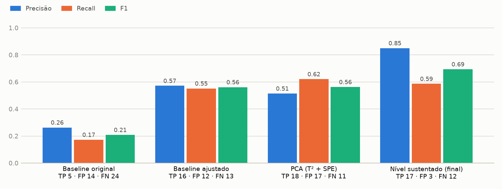
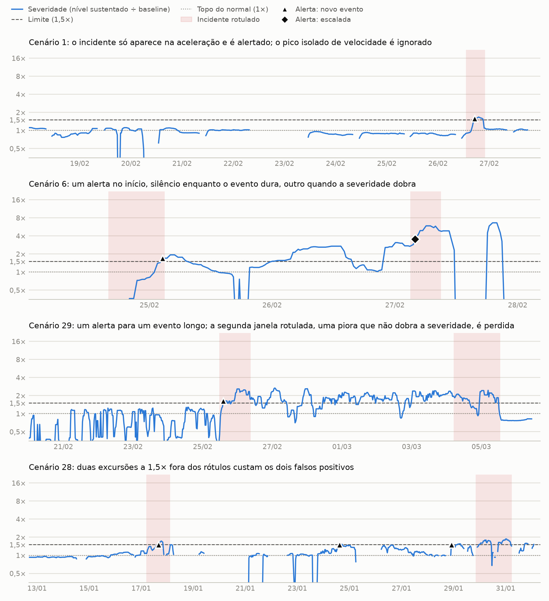
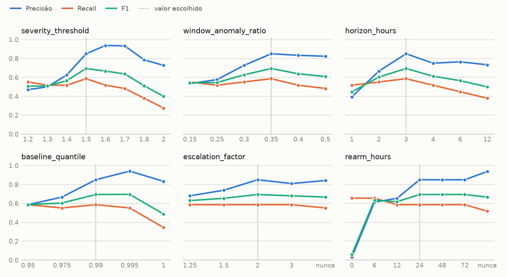

# Detecção de anomalias de vibração — relatório

## Resumo

| | TP | FP | FN | Precisão | Recall | F1 |
|---|---|---|---|---|---|---|
| Baseline como veio | 5 | 14 | 24 | 0,26 | 0,17 | 0,21 |
| Baseline ajustado (só no notebook) | 16 | 12 | 13 | 0,57 | 0,55 | 0,56 |
| PCA (T² + SPE) | 18 | 17 | 11 | 0,51 | 0,62 | 0,56 |
| **Nível sustentado (final, o que o `main.py` roda)** | **17** | **3** | **12** | **0,85** | **0,59** | **0,69** |
| Final, com os hiperparâmetros escolhidos sem o cenário pontuado | 14 | 5 | 15 | 0,74 | 0,48 | 0,58 |



Cheguei à solução final em três etapas. Primeiro corrigi o baseline com o mínimo de mudanças (o **baseline ajustado**). Depois implementei um detector multivariado (**PCA com T² e SPE**), que empatou com ele em F1. A análise dos erros das duas abordagens mostrou o que limitava ambas, e foi isso que levou à **abordagem final**:

- o modelo mede o nível de vibração que a máquina *sustentou* nas últimas 3 horas, na norma da velocidade e na norma da aceleração;
- esse nível é expresso como múltiplo do topo do normal daquela máquina (o percentil 99 do treino com ela rodando);
- o motor de alertas gera um alerta quando um evento começa, fica em silêncio enquanto ele dura, alerta de novo se a severidade dobrar e rearma depois de 24 horas sem anomalia.

Os falsos positivos caíram de 12–17 para 3, com praticamente o mesmo recall.

O número que eu levaria a uma conversa sobre ativos novos é o da última linha da tabela (F1 0,58): os hiperparâmetros foram escolhidos nos mesmos 29 cenários em que são medidos.

Todo número deste relatório vem de `uv run main.py` ou de `notebooks/detection_analysis.ipynb`. A seção do notebook que gerou cada um aparece entre parênteses (§).

---

## 1. Métricas: o que escolhi olhar e como interpreto

### O que a métrica oficial mede

- Um incidente é **encontrado** (TP) quando pelo menos um alerta cai dentro da janela rotulada.
- Todo alerta fora de qualquer janela é um **falso positivo** (FP).
- Precisão, recall e F1 são calculados sobre as somas dos 29 cenários (micro).

É uma métrica no nível do *evento*, o que combina com o produto. Mas ela tem pontos cegos que precisei conhecer antes de confiar nela:

- **Alerta antecipado conta como erro.** Um alerta uma hora antes do início do rótulo é um FP, mesmo sendo exatamente o aviso precoce que o produto quer. Em vários cenários a vibração já está alta horas ou dias antes do rótulo (§15).
- **Repetição dentro do rótulo é de graça.** Dez alertas dentro do mesmo incidente valem o mesmo que um. O requisito 2 (não repetir alertas) não é medido.
- **O atraso não é medido.** `utils.lead_time` existe, mas não pode ser chamado: passa quatro argumentos para `overlap`, que recebe três.
- **Um rótulo é impossível.** O primeiro incidente do cenário 7 termina antes de começar (23:00 → 15:00 do mesmo dia), então o recall máximo é 28/29.
- **Pouca amostra.** São 29 incidentes, e um alerta a mais ou a menos move o F1 em cerca de 0,02.

### O que olhei além do F1 (§17)

| Métrica | Por que olhar | Original | Ajustado | PCA | **Final** |
|---|---|---|---|---|---|
| F1 oficial | a régua do desafio | 0,21 | 0,56 | 0,56 | **0,69** |
| F2 (recall pesa 4×) | perder uma falha custa mais que um alarme falso | 0,19 | 0,56 | 0,60 | **0,62** |
| FP por ativo a cada 30 dias | fadiga de alarme, como é sentida em campo | 0,75 | 0,64 | 0,91 | **0,16** |
| Ativos sem incidente que geraram alerta (de 7) | o falso positivo mais simples | 4 | 0 | 0 | **0** |
| Alertas por incidente encontrado | requisito 2 | 1,00 | 1,12 | 1,00 | **1,06** |
| Atraso mediano do 1º alerta (h) | detectar cedo é o objetivo | 4,1 | 3,0 | 4,6 | **4,1** |
| F1 aceitando alertas até 24 h antes do rótulo | quanto do FP é aviso antecipado | 0,33 | 0,65 | 0,70 | **0,73** |
| F1 macro (média por cenário com incidente) | evita que poucos cenários dominem | 0,18 | 0,53 | 0,52 | **0,59** |
| Intervalo de 90% do F1 (bootstrap de cenários) | incerteza por ter só 29 cenários | 0,08–0,33 | 0,44–0,68 | 0,46–0,67 | **0,54–0,83** |

O monitoramento soma 559 dias-ativo em 29 ativos.

### Como interpreto

- **A abordagem final ganha em quase todas as réguas.** O ganho vem da precisão: ela gera 0,16 alarme falso por máquina por mês, contra 0,64 a 0,91 das outras.
- **Em recall, o PCA encontra um incidente a mais.** O F2, que favorece o recall, deixa a diferença pequena (0,62 contra 0,60). Para o PCA valer a pena, o produto teria de aceitar quase seis vezes mais alarmes falsos por um incidente a mais, e eu não acho que valha.
- **A tolerância de 24 h revela o que a métrica oficial esconde.** Com ela, o PCA passa de 18 para 22 incidentes encontrados: muitos dos falsos positivos dele são avisos antecipados de incidentes reais. A final passa de 17 para 18, porque os falsos positivos dela não estão colados nos rótulos.
- **Diferenças pequenas são empate.** Com o intervalo do bootstrap, diferenças de F1 abaixo de uns 0,05 não significam nada. Nas mesmas reamostragens, a final ganha +0,13 de F1 sobre o baseline ajustado (intervalo de 90% de 0,00 a +0,26; melhor em 94% das reamostragens) e +0,13 sobre o PCA (−0,05 a +0,31; 88%). É a única diferença do estudo que chega perto de se separar do ruído, mas o limite inferior ainda toca o zero: "provavelmente melhor", não "comprovadamente melhor".
- **A estimativa honesta de desempenho é a validação deixando um cenário de fora**, não o F1 na amostra (seção 4.3).

**O que eu reportaria:** o F1 oficial, o F1 fora da amostra, os falsos positivos por ativo por mês e o atraso mediano. Juntos, respondem às perguntas de quem recebe os alertas: quanto confiar no número, quanto ruído esperar e com quanto atraso o aviso chega.

---

## 2. Análise do baseline

O baseline tira a norma dos três eixos de velocidade. Calcula média e desvio-padrão sobre o período de treino inteiro. Marca uma janela quando pelo menos 20% das leituras têm `|z| > 3`. O motor de alertas alerta na primeira janela anormal e trava para sempre. Conferi cada fraqueza nos dados, não só no código.

### 2.1 Detecção

| # | Fraqueza | O que encontrei nos dados |
|---|---|---|
| D1 | **Só velocidade.** A aceleração, onde aparecem falhas de alta frequência (rolamentos, engrenagens), é ignorada. | Acrescentar a norma da aceleração encontra 3 incidentes a mais no baseline ajustado (§4). Na abordagem final, só a velocidade encontra 13 incidentes; velocidade e aceleração juntas, 17 (§16). No cenário 1, o incidente aparece só na aceleração. |
| D2 | **Máquina parada entra no "normal".** Média e desvio incluem as leituras com `uptime = False`, que ficam no piso de ruído do sensor. | A distribuição de treino fica bimodal: a média cai e o desvio infla. No cenário 28, por exemplo, a média é 4,83 ± 4,20 mm/s sobre todas as leituras e 8,36 ± 1,56 só com a máquina rodando. O tempo parado vai de 0% a 74% conforme o ativo, então o limite efetivo muda de ativo para ativo por acaso. |
| D3 | **Teste bilateral.** `abs(z)` trata vibração *baixa* como anomalia, mas o requisito é vibração *alta*. | Só olhar para cima tira 3 falsos positivos sem perder nenhum incidente (§4). Em três cenários (3, 15 e 26), a máquina parada sozinha já passa de `|z| > 3`. |
| D4 | **Média e desvio-padrão não são robustos.** | No cenário 17, uma única leitura de 316 mm/s entre 2.235 eleva o desvio de 1,9 para 6,9 e o limite de 3σ de 10 para 25 mm/s, numa máquina que roda a cerca de 5 mm/s. |
| D5 | **Limite gaussiano em dados que não são gaussianos.** | Os ativos são multi-regime, ligam e desligam ou têm cauda pesada. A maior leitura do treino fica de 1,3 a 43,8 desvios da média conforme o ativo (§13), então "3σ" não quer dizer a mesma coisa em dois ativos. |
| D6 | **Sem severidade.** `PredictOutput` só tem um booleano. | Sem saber *quão* anormal está uma janela, é impossível implementar o requisito 3 (re-alertar quando piora). |
| D7 | Menores: `z_threshold` é `int` (2,5 não pode ser configurado), e o desvio arredondado para três casas pode virar zero num ativo de amplitude baixa. | |

### 2.2 Alertas

| # | Fraqueza | O que encontrei nos dados |
|---|---|---|
| A1 | **Trava para sempre.** `locked` nunca volta a `False`: um alerta por ativo, na vida inteira. | Sete cenários têm dois incidentes, então no máximo 22 dos 29 poderiam ser encontrados. Pior: um falso positivo gasta o único alerta. Em dez cenários com incidente, o único alerta saiu antes do incidente, e o ativo ficou mudo quando importava. Nos cenários sem incidente, a primeira janela ruidosa vira FP (4 dos 7). |
| A2 | **Sem escalada.** | O requisito 3 não é atendido. |
| A3 | **Sem noção de fim de evento.** | O requisito 2 só é atendido por efeito colateral da trava. |

Trocar só o motor de alertas, sem mexer no detector, já leva o F1 de 0,21 para 0,49 (§4). **A lógica de alerta pesa tanto quanto o detector.**

### 2.3 Pipeline

- **Um buraco de telemetria maior que a janela encerra a inferência.** `_windowing_ts` para na primeira janela vazia.
  - Com as janelas de 2 h do YAML original, os cenários 5, 27 e 28 deixam de ser pontuados nas últimas 128, 120 e 266 horas. Cada um perde um incidente (§1).
  - O código é fixo, mas o tamanho da janela é um hiperparâmetro. Uma janela maior que o maior buraco (10,1 h, no cenário 28) resolve.
- **O enunciado e o código discordam sobre o motor de alertas.** O enunciado descreve um estágio de *buffering* e `AlertEngine.predict(List[PredictOutput])`. O `data_pipeline.py` fixo chama o motor janela a janela, com um único `PredictOutput`. Meu motor aceita as duas formas.

---

## 3. Metodologia

### 3.1 A linha de raciocínio


**Primeiro corrigi o baseline com o mínimo de mudanças (§4).** Mantive a regra "20% das leituras acima de k desvios" e fiz uma mudança por vez, medindo cada uma:

1. Troquei a trava por um motor de alertas por eventos: F1 0,21 → 0,49. Esse motor abre o evento em 3 janelas anormais seguidas, fica em silêncio enquanto ele dura, fecha após 24 janelas normais e re-alerta quando a severidade dobra.
2. Passei a olhar só desvios para cima: 0,52.
3. Acrescentei a norma da aceleração: 0,54, com 3 incidentes a mais e 6 FP a mais.
4. Passei a usar só as leituras com a máquina rodando. Isso é o certo, mas sozinho derruba o F1 para 0,41: sem as leituras paradas o desvio encolhe, e 3σ vira um limite apertado demais. Com k = 4,5 o F1 volta a 0,54, com a melhor precisão da série.
5. Aumentei a janela para 12 h com passo de 1 h, julgando só as últimas 2 h, para não perder dados depois dos buracos: 0,56.

**Depois implementei o PCA (T² + SPE).** A ideia era aproveitar a correlação entre os seis canais (em log): o T² mede desvios *ao longo* da estrutura normal (todos os eixos subindo juntos), e o SPE mede desvios *fora* dela (um eixo subindo sozinho). Os dois índices, cada um dividido pelo próprio limite, viram uma severidade, e as contribuições por variável dizem qual canal puxou o alerta. Resultado: 18/17/11, **o mesmo F1 de 0,56** do baseline ajustado. O PCA encontra dois incidentes a mais e paga com cinco FP a mais. Os dois concordam em normal/anormal em 85% das janelas.

**Testei várias coisas que não ajudaram (§9 a §15):**

- **Features da janela.** Pico, dispersão, razão velocidade/aceleração, RMS, fator de crista, curtose e assimetria, tanto no PCA quanto na regra do baseline. As de nível repetem o que a regra já vê; as de forma não têm sinal. Os dados são RMS a cada ~10 min, sem forma de onda, então curtose e fator de crista *do sinal* nem podem ser calculados.
- **Colunas julgadas.** Seis canais em vez de duas normas, log, mediana e MAD: todos pioram.
- **Limite calculado por ativo, a partir do treino.** As 30 variantes ficam todas abaixo do limite único (0,38–0,54).
- **Limiar dinâmico (média móvel + desvio móvel).** Com janelas de 24–72 h, a falha entra na referência e o limiar a absorve (0,26–0,47). Só um horizonte de 14 dias com piso empata.
- **Regras de re-alerta.** CUSUM e tendência perdem para "o nível dobrou".
- **Combinações dos dois detectores.** Exigir concordância entre eles dá F1 0,59; aceitar qualquer um dos dois, 0,48.

Nenhuma variante se separou do baseline ajustado além do ruído do bootstrap.

**Os erros mostraram o que realmente limitava as duas abordagens (§13, §15):**

1. **O z-score não significa a mesma coisa em ativos diferentes.** Um limite escolhido por cenário com os rótulos chegaria a F1 0,80, com k variando de 2 a 20. Ou seja, o problema não era o *valor* do limite, era a *unidade*.
2. **Eventos abertos cedo custam em dobro.** Cinco incidentes do ajustado foram perdidos porque um alerta saiu antes do rótulo, num desvio que já existia. Cada um custou um FP e um FN ao mesmo tempo.
3. **A confirmação em 3 janelas compensava um detector ruidoso, mas tem custos.** Ela perde incidentes curtos (quatro duram 3 h ou menos), atrasa o alerta e faz o motor depender do passo do pipeline. Contar janelas também conta as janelas repetidas dentro de um buraco como "tempo normal".

A abordagem final ataca esses três pontos: troca a unidade (razão ao topo do normal em vez de desvios-padrão), põe a evidência sustentada dentro do modelo, e faz o motor medir o tempo pelos timestamps.

### 3.2 Famílias de abordagem: vantagens e desvantagens

Testei duas famílias:

- **Estatística multivariada:** o PCA com T² e SPE sobre os seis canais.
- **Regras univariadas sobre as normas de velocidade e aceleração:** o baseline ajustado (z-score) e a abordagem final (razão ao percentil 99).

| | Multivariada (PCA, T² + SPE, 6 canais em log) | Univariada sobre normas (ajustado e final) |
|---|---|---|
| **O que enxerga** | A estrutura de correlação entre os eixos. O SPE pega um eixo que sobe sozinho. | O nível de energia em cada tipo de sensor. Velocidade cobre as falhas de baixa frequência (desbalanceamento, desalinhamento, folga); aceleração, as de alta frequência (rolamentos, engrenagens). |
| **Falha num eixo só** | ✅ Forte. Um canal ×2 é sinalizado em 69% dos casos (§16). | ❌ Fraca: a norma dilui o eixo. O mesmo canal ×2 é sinalizado em 4% dos casos pela final. |
| **Diagnóstico** | ✅ Contribuição por variável: o canal certo vem em primeiro em ~92% dos casos (§8). | ⚠️ Só diz qual norma puxou a severidade (`driver`). |
| **Ruído e falsos positivos** | ❌ Mais sensível também ao que é normal: 17 FP. A cada canal, uma chance a mais de uma variação comum disparar. | ✅ A norma é estável e não depende de como o sensor foi montado: 3 FP na final. |
| **Hipóteses** | ❌ Estrutura linear e um único regime de operação, o que não vale para ativos com vários regimes. Limite empírico sobre dados autocorrelacionados. Padronizar pelo MAD deixa ativos muito estáveis hipersensíveis. | ✅ A razão ao quantil não supõe distribuição. ⚠️ A variante z-score supõe, e por isso o mesmo k não vale entre ativos. |
| **Hiperparâmetros** | ❌ Muitos: variância retida, quantil, margem, piso do MAD, descarte de outliers, fração da janela. | ✅ Poucos e físicos: quantil do baseline, horizonte, fração do horizonte, limite. |
| **Explicabilidade** | ❌ "T² + SPE = 1,8× o limite" não diz nada a um analista. | ✅ "A aceleração está a 1,6× o topo do normal desta máquina" é a linguagem que analistas de vibração já usam. |
| **Direção** | ⚠️ Bilateral por construção; precisa de uma regra extra para olhar só para cima. | ✅ Só para cima, naturalmente. |

**Por que escolhi a família univariada como padrão.** Os 29 incidentes rotulados são, na maioria, mudanças de nível que movem a norma inteira. Nesse cenário, a vantagem do PCA (falhas de um eixo) rende um incidente a mais, e o custo dele (ruído) rende 14 alarmes falsos a mais. A final também é mais simples de explicar, de ajustar e de manter.

O PCA não é descartado: ele é a melhor ferramenta para o ponto fraco da final. Por isso fica em `classes/pca_model.py` e aparece nos próximos passos (seção 5) como um segundo sinal, com um limite mais alto, para recuperar as falhas de um eixo só.

### 3.3 Abordagem final — detecção (`classes/anomaly_model.py`)

**Features.** Duas por leitura: a norma da velocidade e a norma da aceleração.

**Fit.** Para cada norma, o baseline é o **percentil 99 das leituras com a máquina rodando** no treino. O período de amostragem mediano também é guardado.

**Predict.** O modelo olha só as leituras com a máquina rodando nas **últimas 3 h** da janela:

- o **nível sustentado** de cada norma é o nível atingido em pelo menos 35% do horizonte (cerca de 1 h de 3). Na prática, é a k-ésima maior leitura, com k = 0,35 × 3 h ÷ período de amostragem;
- a **severidade** é a maior razão nível sustentado ÷ baseline entre as duas normas;
- a janela é anormal quando a severidade é **≥ 1,5**.

`PredictOutput` ganhou `severity` e `driver`, ambos com valor padrão, então o contrato existente não muda.

| Decisão | Por quê | Fraqueza que resolve |
|---|---|---|
| Velocidade **e** aceleração | Cada uma vê uma família de falhas. Só velocidade encontra 13 incidentes; só aceleração, 8; as duas juntas, 17. | D1 |
| Normas em vez dos seis eixos | A norma não depende de como o sensor foi montado e é bem mais estável. Os seis eixos separados encontram os mesmos 17 incidentes, mas com 13 FP em vez de 3. | ruído |
| Baseline só com a máquina rodando | Máquina parada não diz nada sobre a condição dela. | D2 |
| Percentil 99 em vez de média + kσ | Não supõe distribuição e tem o mesmo significado num ativo bimodal, multi-regime ou de cauda pesada: "o topo do que esta máquina faz normalmente". Até 1% de outliers no treino não o move. | D4, D5 |
| Razão em vez de z-score | É livre de escala, então um único limite serve para todos os ativos. Um z-score explode em sinais muito estáveis. | D5 |
| Só para cima | O requisito é vibração alta. | D3 |
| k-ésima maior leitura em vez de média ou máximo | Ignora picos isolados por construção. Também ignora as leituras ociosas de máquinas que ligam e desligam, que uma média incorporaria. | ruído |
| k contado sobre o horizonte nominal | O requisito é "cerca de 1 h de evidência", não "35% das leituras que por acaso existam". Uma janela com poucas leituras rodando tem severidade 0, e a regra não depende da taxa de amostragem (1, 4, 8,5 e 10 min nos dados). | ruído |
| Horizonte de 3 h | Quatro dos 29 incidentes duram 3 h ou menos. Para alertar dentro deles, a evidência não pode ser mais longa que eles. | atraso |
| Severidade contínua na saída | O motor precisa dela para a escalada, e a mensagem do alerta a usa: `Abnormal vibration escalated: velocity at 3.6x baseline, up from 1.7x.` | D6 |

### 3.4 Abordagem final — motor de alertas (`classes/alert_engine.py`)

O motor acompanha um evento por vez e guarda duas coisas: a severidade no último alerta e o horário da última janela anormal.

```
              janela anormal                   severidade ≥ 2 × a do último alerta
  sem evento ─────────────────► ALERTA ─► evento aberto ───────────────────────────► ALERTA
      ▲                                         │
      └──────── 24 h sem janela anormal ────────┘
```

| Requisito | Como o motor cumpre |
|---|---|
| **1. Detectar** | O evento abre e alerta na **primeira** janela anormal. O modelo já exige cerca de 1 h de evidência, então uma confirmação a mais só atrasaria: testada com 2 janelas, dá 15/6. |
| **2. Não repetir** | Enquanto o evento está aberto, janelas anormais não alertam. O evento só fecha depois de **24 h sem nenhuma janela anormal**: um problema intermitente, que pisca em torno do limite, continua sendo um evento só. |
| **3. Re-alertar na escalada** | Um novo alerta sai quando a severidade chega a **2×** a do último alerta, e a referência sobe para o novo nível. Como a comparação é com o último nível *alertado*, um platô fica em silêncio e uma subida lenta gera um alerta por dobra, não um por janela. |

Mais duas decisões de projeto:

- **O tempo vem dos timestamps, nunca da contagem de chamadas.** O comportamento não muda com o passo do pipeline e sobrevive aos buracos: dentro de um buraco, o pipeline repete a mesma janela várias vezes, e essas repetições não podem contar como "tempo normal".
- **`predict` aceita um `PredictOutput` ou uma lista.** É o contrato do enunciado. Um lote é processado em ordem pela mesma máquina de estados e devolve o primeiro alerta do lote, ou a última decisão se nenhum alerta saiu.


Nos seis perfis da figura, o motor final dá exatamente o número desejado de alertas (§16). Para comparar, o motor que conta janelas, usado pelo ajustado e pelo PCA, falha no perfil intermitente: um problema que pisca nunca tem três janelas anormais seguidas e nunca é alertado.

### 3.5 Pipeline (`hyperparameters/pipeline_hyperparams.yaml`)

- **Janela de 12 h.** Ela só precisa ser maior que o maior buraco de telemetria (10,1 h). O modelo julga só as últimas 3 h, então uma janela longa não custa tempo de reação. O preço é um aquecimento: a primeira decisão sai 12 h depois do início do período, e o incidente mais cedo começa 64 h depois.
- **Passo de 30 min** (sobreposição de 11,5 h). É de quanto em quanto tempo o ativo é reavaliado. O experimento inteiro roda em cerca de 15 s.

### 3.6 Como escolhi os hiperparâmetros

Cada valor partiu de um argumento físico (as tabelas acima) e depois foi conferido contra os rótulos numa vizinhança desse ponto. Como não há um conjunto de teste separado, fiz duas coisas para não me enganar:

- **Sensibilidade, um parâmetro por vez:** para ver se o valor escolhido fica num platô ou num pico de sorte (seção 4.3).
- **Validação deixando um cenário de fora:** para cada cenário, escolhi a melhor configuração de uma grade de 108 pontos usando os outros 28 e pontuei o que ficou de fora.

---

## 4. Desempenho

### 4.1 Métricas finais (`uv run main.py --no-plot`)

```json
{"runs": 29, "TP_total": 17, "FP_total": 3, "FN_total": 12,
 "precision_global": 0.85, "recall_global": 0.586, "f1_global": 0.694}
```

- 26.179 janelas pontuadas, 923 marcadas como anormais e 21 alertas (2 deles escaladas).
- Os sete cenários sem incidente ficam sem nenhum alerta.
- O primeiro alerta sai uma mediana de **4,1 h** depois do início do rótulo (quartis de 1,6 e 10,6 h, máximo de 23,7 h).
- As métricas complementares estão na seção 1.

### 4.2 Os três requisitos nos dados



- **Cenário 1:** o incidente aparece só na aceleração e é alertado a 1,6×. O pico isolado de velocidade antes dele não move o nível sustentado.
- **Cenário 6:** um alerta no início (1,7×), silêncio enquanto o evento dura, e outro alerta quando a severidade dobra (3,6×), dentro do segundo incidente rotulado.
- **Cenário 29:** um único alerta para um evento de vários dias, sem repetição (requisito 2). A segunda janela rotulada é uma piora que não chega a dobrar a severidade e não gera alerta.
- **Cenário 28:** duas excursões a 1,5× fora dos rótulos geram os dois falsos positivos desse ativo.

### 4.3 Sensibilidade e validação fora da amostra



- **`severity_threshold = 1,5`.** Fica no começo de um platô à direita (0,67 em 1,6 e 0,64 em 1,7). À esquerda o ruído entra rápido (0,57 em 1,4 e 0,51 em 1,3).
- **`horizon_hours = 3`.** É um pico (0,60 em 2 h e 0,61 em 4 h). É o parâmetro mais sensível e o que eu mais gostaria de revalidar com mais dados.
- **`baseline_quantile`.** Tem platô em 0,99–0,995. O máximo (1,0) depende de uma única leitura e derruba o F1 para 0,49.
- **Motor de alertas.** O fator de escalada quase não importa (0,63–0,69), e o rearme tem platô de 24 a 72 h. Rearmar a cada janela gera 589 falsos positivos; nunca rearmar (a trava do baseline) perde dois incidentes.
- **Janela e passo.** 24 h dá o mesmo que 12 h. A janela de 6 h parece melhor (17/1/12, F1 0,72), mas é um efeito colateral: com 6 h o janelamento para no buraco de 10,1 h do cenário 28, os últimos 10 dias desse ativo deixam de ser pontuados, e os dois falsos positivos somem junto. Passo de 1 h piora (16/7/13).

**Fora da amostra:** escolhendo limite, fração do horizonte, horizonte e fator de escalada sem o cenário pontuado, a soma dá **14/5/15, F1 0,58**. A configuração do YAML é escolhida em 25 das 29 dobras. Na amostra, a mediana da grade de 108 pontos também é 0,58. Na mesma validação, o baseline ajustado cai de 0,56 para 0,47 (§13).

### 4.4 Análise de erros


**Os 12 incidentes perdidos:**

| Causa | Incidentes | Comentário |
|---|---|---|
| Rótulo invertido | 7a | Impossível de encontrar. |
| Severidade abaixo de 1,5× | 7b, 11, 12, 13, 14, 17, 26, 27a | No 11 a severidade nem chega ao topo do normal (0,76×). Nos outros sete, o nível sustentado fica de 16% a 38% acima do topo do normal (1,16× a 1,38×), abaixo do limite. São mudanças reais, mas pequenas. |
| Evento já aberto, sem dobrar | 27b, 28b, 29b | O alerta saiu antes, num desvio que continuava (severidade dentro do rótulo de 1,4 a 2,5). É o requisito 2 funcionando: a métrica oficial conta isso como FN. |

**Os 3 falsos positivos:**
- Um no cenário 27, 58 h antes de um rótulo, num desvio que continua até ele.
- Dois no cenário 28, em excursões a 1,5× sem rótulo, a 126 h e a 23 h do segundo incidente.

**Comparado com o ajustado e o PCA** (gráfico da direita), a abordagem final gera menos falsos positivos, e só um dos três fica a menos de 48 h de um rótulo. No ajustado são 7 de 12, e no PCA 8 de 17: boa parte dos falsos positivos deles são avisos antecipados de incidentes reais.

---

## 5. Limitações e trabalhos futuros

**Limitações do que estou entregando**

- **Escolhido e medido nos mesmos 29 cenários.** Num ativo novo, eu esperaria um F1 perto de 0,58, não 0,69.
- **Fraca em falhas de um eixo só** e em mudanças que ficam dentro da faixa do treino (7b, 17, 26). É o preço da norma e do limite de 1,5×: um canal ×2 é sinalizado em 4% dos casos.
- **Baseline fixo.** Um ativo que muda de regime legitimamente depois do treino alerta uma vez e fica num evento aberto. Um ativo que sobe devagar só é visto quando cruza 1,5×.
- **A escalada olha só a pior norma.** Se a velocidade está a 3× e a aceleração sobe de 1× para 2×, nada é gerado.
- **Aquecimento de 12 h** no início de cada série, e o primeiro alerta de um evento precisa de cerca de 1 h de evidência.

**O que eu faria a seguir, em ordem**

1. **Recuperar as falhas de um eixo sem trazer o ruído de volta.** Usar o PCA (ou uma severidade por eixo) como segundo sinal, com um limite mais alto, ao lado da final. Com a forma de onda disponível, acrescentar energia por banda, fator de crista e curtose, que separam falha de rolamento de mudança de processo muito melhor que o RMS.
2. **Baseline por regime de operação.** Muitos ativos têm dois ou três regimes. Um baseline por regime (agrupado a partir do treino, ou guiado por carga ou rotação, se existirem) apertaria o envelope o bastante para ver as mudanças de 16–38% acima do topo do normal dos cenários 13, 14 e 17.
3. **Dois níveis de severidade.** Um aviso de baixa prioridade a partir de ~1,2× sustentado por muitas horas, e o alerta atual em 1,5×. Isso combina com o comportamento dos rótulos: vários foram marcados só onde o nível ficou claramente alto.
4. **Um baseline que envelhece bem.** O notebook mostrou que uma referência móvel de 14 dias com piso encontra incidentes onde o normal da predição se afastou do treino (§14). Faltam mais dados para validá-la.
5. **Escalada por norma**, guardando a severidade alertada de cada norma em vez da máxima.
6. **Avaliação.** Corrigir o rótulo do cenário 7, aceitar alertas com uma tolerância antes do rótulo, medir o atraso, e revisar com quem rotulou os dados as excursões sem rótulo (cenário 28). Com mais ativos rotulados, daria para ter um teste separado de verdade e limites por classe de ativo.
7. **Robustez do pipeline**, se esse código for aberto: pular janelas vazias em vez de parar, janelar de forma incremental em vez de varrer a série a cada janela, e persistir o estado do motor entre reinícios.

---

## 6. Como reproduzir e conformidade com o enunciado

```bash
uv run main.py --no-plot                                     # métricas em experiment_outputs/
uv run jupyter lab notebooks/detection_analysis.ipynb        # análise completa (~10 min executando tudo)
uv run --with matplotlib python -m analysis.report_figures   # figuras deste relatório, a partir de docs/figures/tables/
                                                             # (o notebook regrava essas tabelas)
```

| Arquivo | O que mudou |
|---|---|
| `classes/anomaly_model.py` | Reescrito: abordagem final (nível sustentado ÷ baseline). |
| `classes/alert_engine.py` | Reescrito: eventos medidos pelo tempo, escalada e rearme. Aceita um `PredictOutput` ou uma lista. |
| `classes/interface.py` | `Weights`, `ModelParams`, `PredictOutput` e `AlertDecision` estendidos (campos novos com valor padrão). Entraram `AlertParams` e os parâmetros das alternativas (`PcaWeights`, `PcaModelParams`, `WindowAlertParams`). `DataPoint`, `TimeSeries`, `PipelineParams` e `TrueIncident` estão intactos. |
| `classes/pca_model.py`, `classes/window_alert_engine.py` | Novos: o PCA e o motor que conta janelas, mantidos como alternativas para o notebook. O caminho padrão (`main.py`) não os usa. |
| `hyperparameters/*.yaml` | Valores novos para modelo, alertas e pipeline; `pca_hyperparams.yaml` e `window_alert_hyperparams.yaml` para as alternativas. |
| `notebooks/detection_analysis.ipynb` | Toda a análise; seções 16 (abordagem final) e 17 (métricas). |
| `analysis/report_figures.py`, `docs/figures/` | As figuras deste relatório e as tabelas que as alimentam. |

**Conformidade com o enunciado:**
- `main.py`, `classes/data_pipeline.py`, `utils/` e `labels/` são idênticos aos arquivos originais do desafio.
- As interfaces são as pedidas: `AnomalyModel.fit(TimeSeries)`, `AnomalyModel.predict(TimeSeries) -> PredictOutput` e `AlertEngine.predict(List[PredictOutput]) -> AlertDecision`. `AnomalyModel()` e `AlertEngine()` funcionam sem argumentos, como o pipeline fixo os cria.
- O dataset fica fora do repositório (`data/` está no `.gitignore`).
- matplotlib é pedido só no comando das figuras, então `pyproject.toml` e `uv.lock` não mudaram.
